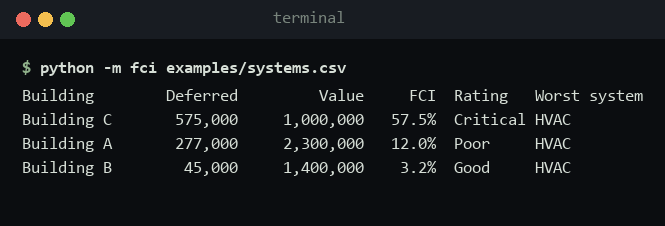

# facility-condition-index

[](https://github.com/yassine2med/facility-condition-index/actions/workflows/ci.yml)  

Calculates the Facility Condition Index per building from a CSV of building systems.



## What it is for

The Facility Condition Index (FCI) compares the cost of overdue repairs in a building to what it would cost to replace the building systems. It is a standard way to rank buildings for capital funding. A capital planner, facility manager or asset manager uses this tool to turn a list of systems (HVAC, roof, electrical) into one ranked table. It adds the rows up per building and prints the FCI, a rating and the system with the highest repair-to-value ratio.

## Install

```
git clone https://github.com/yassine2med/facility-condition-index
cd facility-condition-index
pip install -r requirements.txt
```

## How to use

| I want to | Command |
| --- | --- |
| Print the FCI table, worst building first | `PYTHONPATH=src python -m fci examples/systems.csv` |
| Get a Markdown table for a report | `PYTHONPATH=src python -m fci examples/systems.csv --format md` |
| See all options | `PYTHONPATH=src python -m fci --help` |

Input columns: `building`, `system`, `repair_cost`, `replacement_value`. Run the tests with `python -m pytest -q`.

Worked example:

```
PYTHONPATH=src python -m fci examples/systems.csv
```

Output:

```
Building        Deferred         Value     FCI  Rating   Worst system
Building C       575,000     1,000,000   57.5%  Critical HVAC
Building A       277,000     2,300,000   12.0%  Poor     HVAC
Building B        45,000     1,400,000    3.2%  Good     HVAC
```

## How it works

1. Rows are grouped by building.
2. Deferred maintenance is the sum of `repair_cost`; replacement value is the sum of `replacement_value`.
3. FCI is deferred maintenance divided by replacement value.
4. Rating bands: up to 5 percent Good, up to 10 percent Fair, up to 30 percent Poor, above that Critical. A value on a limit takes the better band. These are commonly quoted bands, and the function accepts your own.
5. The worst system is the one with the highest repair cost divided by its own replacement value.
6. Buildings are listed worst first.

## Limits

- It does not estimate repair costs. They come from your own assessments.
- A building with a zero or negative replacement value stops the run with an error.
- One year only. It does not track FCI over time.

## License

MIT. Yassine Emhamed, 2026.
